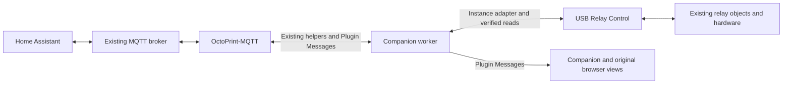

# MQTT for USB Relay Control

An event-driven OctoPrint companion that exposes the relays configured by
USB Relay Control through the existing OctoPrint-MQTT connection.

**Development version. The project owner reports successful use on real hardware.**
The full manual test plan remains to be documented; no public release is available yet.
Licensed under [AGPL-3.0-or-later](LICENSE). Maintainer: Eitschman.
The initial public release and official registration are still pending.

The companion uses existing relay objects and MQTT helpers. It never opens USB
or a second MQTT connection, polls hardware, changes the original plugin on disk,
or calls another plugin over HTTP. ON and OFF are verified by reading the actual
relay state. Unknown state stays unknown. Retained commands are rejected.

MQTT helper acceptance does not prove delivery. Subscriptions use the upstream
helper's effective QoS 0. Publications request QoS 0, retained storage and no offline
queue. Reconnection reads current state instead of replaying a message history.

## Development

Python 3.11 or later is required. The primary contract targets OctoPrint 2.0.1,
USB Relay Control 1.0.0 and OctoPrint-MQTT 0.8.19 or 0.8.20.

```sh
uv sync --group dev
uv run python tools/prepare_upstream.py
uv run pytest
uv run ruff check .
```

Source preparation downloads checksum-pinned public upstream fixtures explicitly.
Tests use synthetic hardware and require no private tools, services or credentials.
Do not point integration tests at an existing printer or Home Assistant instance.

## User and maintainer documentation

- [Installation and configuration](docs/public/installation.md) · [Deutsche Anleitung](docs/public/installation-de.md)
- [MQTT topics and availability](docs/public/mqtt-topics.md)
- [Compatibility and actual test matrix](docs/public/compatibility.md)
- [Architecture](docs/public/architecture.md) · [14 design decisions](docs/adr/0001-companion.md)
- [Troubleshooting](docs/public/troubleshooting.md) · [Privacy](docs/public/privacy.md)
- [Portable development and tests](docs/public/development.md)
- [Authorized hardware test plan](docs/public/manual-test-plan.md) · [Development report](docs/public/development-report.md)
- [Contributing](CONTRIBUTING.md), [support](SUPPORT.md), [security](SECURITY.md), [changelog](CHANGELOG.md)
- [Upstream notices](THIRD_PARTY_NOTICES.md)

Expose individual channels as binary switches, lights or fans. Integration starts
disabled; original configuration and hardware ownership remain with USB Relay Control.
Active Low is applied to logical state. Multiple channels are independent, but identical
VID/PID boards cannot be selected independently by the original driver.

Without polling, only observed software operations and defined reconciliation events
refresh state. Arbitrary untouched hardware faults or external state changes may remain
undetected. A filesystem clone must receive a confirmed new offline instance identity
before MQTT use. See the installation guide for safe cleanup and uninstall behavior.

Development is AI-assisted. Human review and completion of the formal real-device
test plan are release gates, alongside a published release archive and beta approval.
There are no approved public release artifacts or automatic update URLs yet.

## Architecture and prerequisites



Use an existing supported OctoPrint installation, USB Relay Control 1.0.0 and MQTT
0.8.19/0.8.20 with its Last Will enabled. The software-tested OctoPrint minimum is
1.11.2; the primary matrix uses 2.0.1. Home Assistant must already consume the same
broker with discovery enabled. No broker in the printer's Docker host and no extra
MQTT credentials are needed: connection, authentication and TLS remain owned by MQTT.
Original USB access and permissions must already work; this companion installs no
drivers and makes no host permission changes.

## Installation and configuration

After an approved release exists, install its checked ZIP using OctoPrint Plugin
Manager and restart. For the current local development build use only an isolated
test instance; see [installation](docs/public/installation.md). Keep a recoverable
configuration backup before any separately authorized deployment.

Open **Settings → MQTT for USB Relay Control**, enable integration and select each
existing channel to expose. Choose a binary Switch, Light or Fan and optional HA name,
then Save. No second physical-device configuration or manual HA YAML is required.
Active High/Low, VID/PID and channel are inherited from the original configuration.
Use Read current states for an explicit resync; it reads and does not apply defaults.
Missing prerequisites, unknown readback and helper failures remain visible diagnostics.

## MQTT and discovery example

For a synthetic UUID `11111111-2222-4333-8444-555555555555`, default base `octoPrint`
and channel 1 on `16c0:05df`, topics are:

```text
octoPrint/usbrelay/11111111-2222-4333-8444-555555555555/16c0-05df/1/set
octoPrint/usbrelay/11111111-2222-4333-8444-555555555555/16c0-05df/1/state
octoPrint/usbrelay/11111111-2222-4333-8444-555555555555/16c0-05df/1/availability
```

Send exact, **non-retained** `ON` or `OFF` only to `/set`. The discovery identifier is
the UUID without hyphens followed by normalized VID, PID and channel. The generated
configuration contains `command_topic`, `state_topic`, `payload_on: ON`,
`payload_off: OFF`, `retain: false`, `optimistic: false`, `qos: 0`, one shared instance
device and both availability sources with `availability_mode: all`. Light and Fan
remain binary: no brightness, color or speed features are advertised. Full payload
examples and cleanup rules are in [MQTT topics](docs/public/mqtt-topics.md).

Retained replay is rejected before hardware access. MQTT can deliver a *live* retained
publication to an existing subscriber with its retained flag cleared; the public
helper cannot distinguish it from a fresh command. Always configure senders with retain
disabled and remove old retained command payloads before enabling the channel.

Read the [dependency review](docs/public/dependency-review.md) before considering any
deployment: the fixed upstream test baseline has unresolved advisories. Functional
compatibility is not a security endorsement. See [release readiness](docs/public/release-readiness.md)
for remaining human, hardware, beta and publication gates.

[Plugin quality and registry checks](https://github.com/Eitschman/OctoPrint-MQTTForUSBRelayControl/actions/workflows/quality.yml)
run software tests and the official registry validator/site build. The separate
[OctoPrint dependency security audit](https://github.com/Eitschman/OctoPrint-MQTTForUSBRelayControl/actions/workflows/dependency-audit.yml)
remains strict and reports inherited host findings. A passing quality run does not
mean those findings are resolved. See [registry preparation](docs/public/registry.md).
