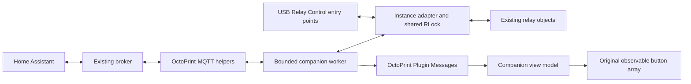

# Architecture

The companion coordinates existing plugin instances. It does not construct a relay,
MQTT client, HID device or inter-plugin HTTP client.

`relay_registry.py` projects the original configuration into normalized UUID/VID/PID/
channel identities. Names, row order and Home Assistant domain do not form identity.
Duplicate normalized channels are rejected; the upstream driver cannot distinguish
multiple physical boards with identical VID/PID.

Device grouping is separate from relay identity. The default uses an active
HomeAssistant Discovery plugin's exact `node_id`; only that plugin's `node_id` and
`node_name` settings are read. An explicit device identifier overrides automatic
grouping; the separate-device option and known missing/disabled optional plugin use
the UUID-based companion device. A transient lookup/read error or invalid identity
keeps the last validated identity/name, loaded from the companion-owned atomic
`device-identity.json` cache after restart if necessary. Without a cache it falls
back to the separate device and reports why. Cache write failures remain visible
without disabling relay operation. A valid new source value replaces the cache.
Explicit overrides bypass this fallback. Reconciliation fingerprints include the optional
identity/name. Its lifecycle events update discovery without rebuilding the relay
adapter. No foreign settings or discovery topics are written. The only shared
metadata published is its name; an explicit custom name may affect the shared device.

`adapter.py` records every instance attribute it owns. It wraps original startup,
settings-save, API entry points and existing relay state methods. A reentrant lock
covers configuration selection, hardware access and relay reconstruction. A real
original settings-save can replace every relay; wrappers bind the replacements and
restore/remove obsolete bindings under the same lock. Per-binding tokens deactivate
retired callbacks even when a foreign wrapper must remain intact. The manifest does
not accumulate obsolete relay instances. The original plugin independently retains
cleanup callbacks through atexit; the companion does not alter that registry.
The companion never invokes that save or startup handler to synchronize state.

After each MQTT write attempt, the same transaction reads controller state and applies
Active High/Low semantics. Target, actual, write error and read error remain separate.
A write may return None even when the HID operation failed: only the readback gives
an actual state. A failed read is unknown, never an invented OFF. Original returns
and exception objects are preserved. Observer failures are isolated. Controller bits
cannot confirm contact position, load voltage or safe electrical operation.

Observations leave the hardware lock before notification or MQTT publication.
`state_manager.py` serializes commands and controls, bounds commands to 128, coalesces
state snapshots and rejects obsolete epochs. Round-robin scheduling between controls,
eligible commands and publication prevents a busy category starving the others.
MQTT commands expire before execution (default 5 seconds), checked on arrival,
dispatch and after acquiring the hardware lock. The default per-channel gap is
250 ms after command completion. Waiting commands preserve order within a channel;
eligible commands on other channels and state publication can proceed. The worker
uses condition deadlines, not periodic checks. Expiry cannot stop a call that has
already started, and original local calls do not use this queue or rate limit.
Disconnect, settings changes and teardown
invalidate pending commands. A running upstream call cannot be forcibly cancelled;
its stale result is discarded and the write is never retried.

`operations.py` records serialized upstream read/write/configuration duration. A
daemon one-shot timer reports calls exceeding 2 seconds without touching hardware
or cancelling the call. The warning is sent outside the monitor lock from its timer
thread; observation delivery still occurs after releasing the hardware lock.
Status exposes the current/last/longest duration and slow-operation count. There
is no periodic status refresh: displayed durations reflect the latest event or
requested status. Teardown waits at most 2 seconds for the adapter lock. A failed
restore leaves wrappers inactive and prevents rebinding until OctoPrint restarts;
the outstanding upstream call may still complete. This is not a hardware timeout.

`lifecycle.py` registers a message receiver before startup. It combines OctoPrint events,
startup/shutdown hooks and observed original calls rather than relying exclusively on
LifecycleManager. Binding retries are limited to 0.5, 1 and 2 seconds. There is no
periodic hardware polling. A quiet hardware failure or external hardware change is
not universally detectable: only observed software paths and explicit reconciliation
(read action, reconnect, birth, relevant configuration changes) refresh state.

MQTT helpers provide no end-to-end delivery acknowledgement. Discovery tombstones
persist after submission and may be submitted again. Ledger corruption stops ownership
changes instead of deleting arbitrary broker topics.

The browser bridge depends on OctoPrint's actual `uSBRelayControlViewModel` identifier
and its Knockout observable arrays. It validates each original row's hardware identity
and mode, replaces plain button items, and reapplies the latest verified snapshot after
an old original REST response. It does not replace original view model methods.

Dependency loss submits owned retained offline availability before closing the old
helper facade. If already disconnected, nothing is queued. A later connection event
submits the currently unavailable state using compatible current MQTT helpers even
while the relay plugin remains unavailable. UUID/epoch checks also protect this path;
it cannot publish a cloned old identity or create an additional connection.
