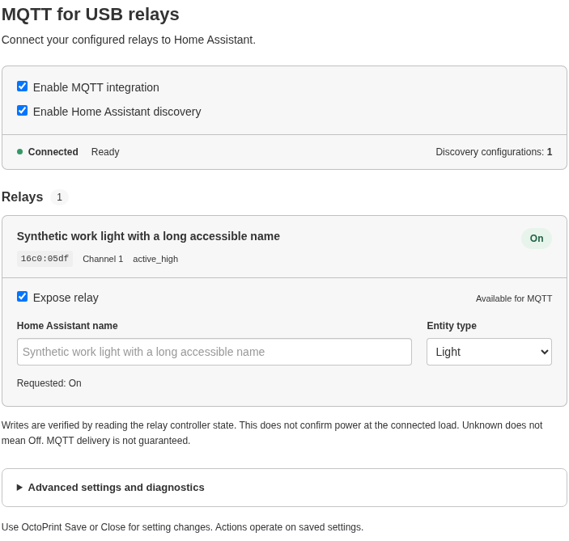
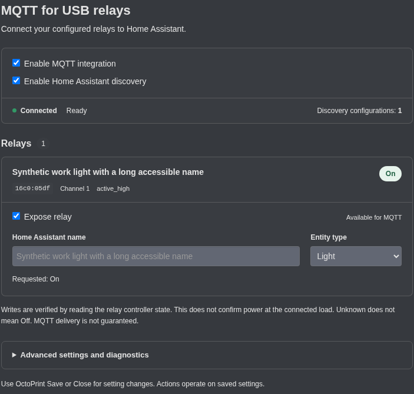
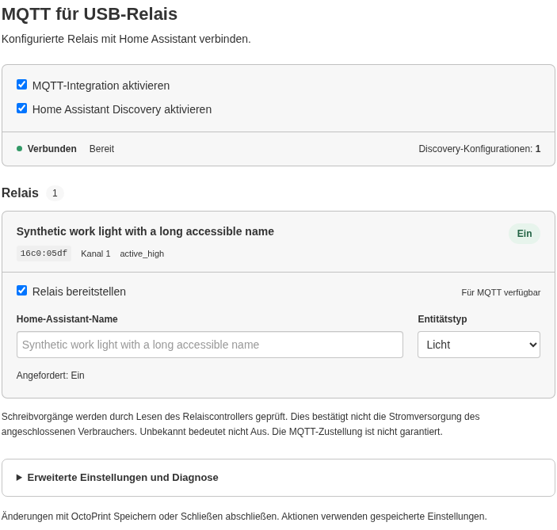
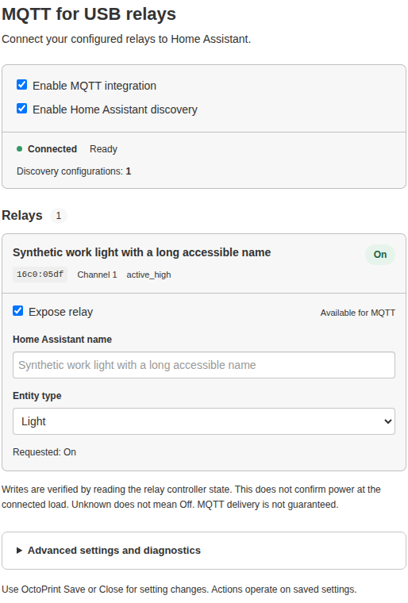
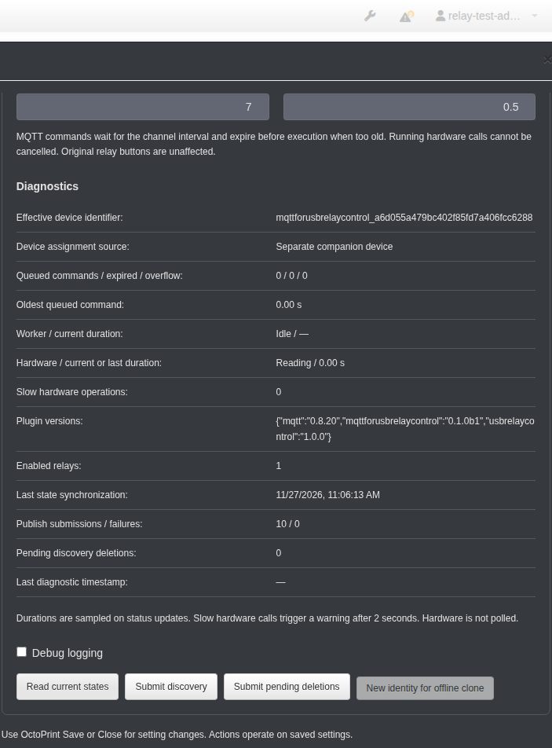
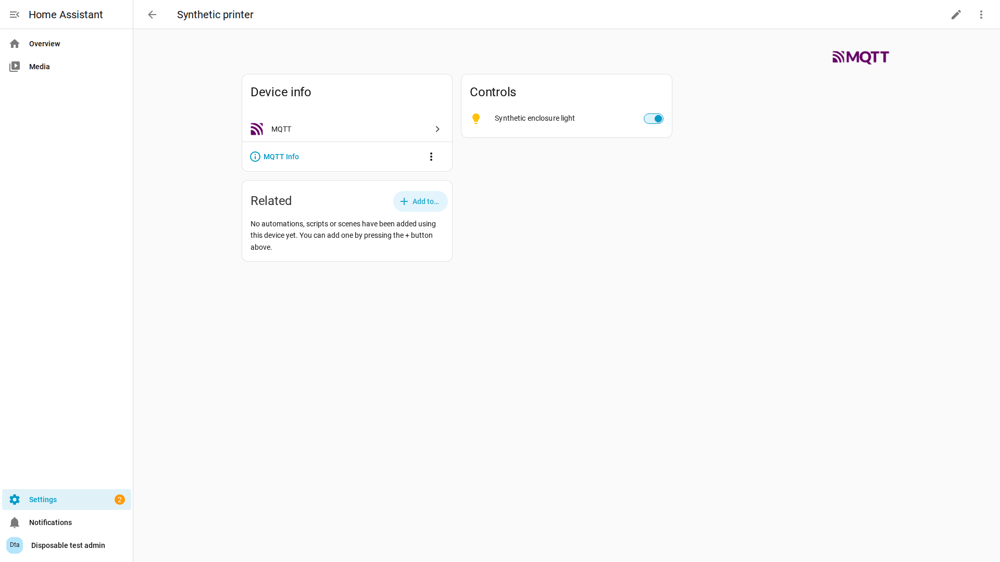
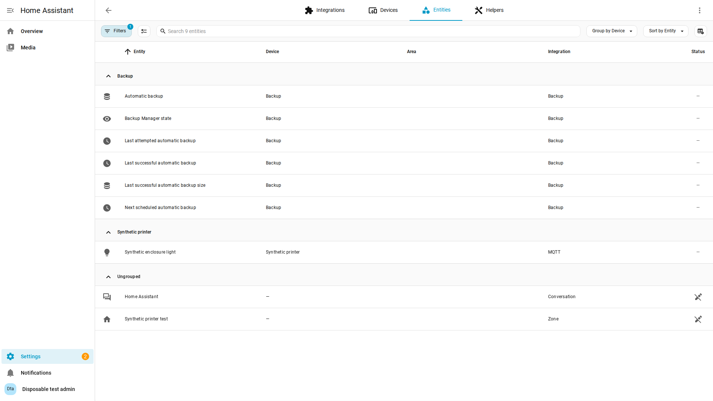

# Screenshots

These are unmodified captures of isolated test applications with synthetic data.
They contain no production printer configuration or credentials. OctoPrint captures
show the `0.1.0b1` candidate on 2026-11-27. Light/dark host colors are applied by the
appearance regression test; they are not evidence of a particular theme plugin.
Home Assistant captures show the existing synthetic integration test on 2026-11-26,
not the owner's installation or a new beta-specific HA test. The HA entities image
shows the light entity; switch/fan schemas are covered separately by automated tests.

The light overview is the featured image. Each image was visually inspected
for cropping and private content during preparation. The owner approved publication of this image set with beta `0.1.0b1`.
The registry template uses the same seven files.

## English settings, light theme

## English settings, dark theme

## German settings

## Compact layout

## Diagnostics

## Home Assistant device

## Home Assistant entities

